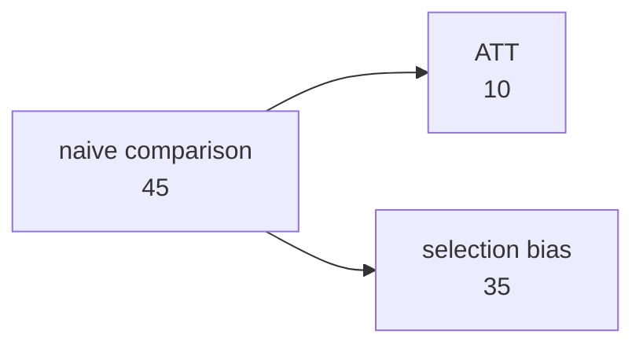

# Lecture 5: Introduction to experiments

**Date:** 15 Oct 2026 (online) · **Lecturer:** Lukas Schmid · [Exercises](exercises.md) · [Notebook](exercises.ipynb)

## Contents

1. [Motivation](#1-motivation)
2. [Experimental research](#2-experimental-research)
3. [Potential outcome framework](#3-potential-outcome-framework)
4. [Key terms](#key-terms)

The slides give the definitions and examples 5.1 to 5.7. The historical detail on the beriberi voyages, the Bing numbers, and the decomposition of the naive comparison in section 3.4 are my additions, sources at the end.

This is the hinge of the course. Lectures 1 to 4 were about what can go wrong. From here on the course builds the machinery that fixes it.

---

## 1. Motivation

#### Example 5.1: Beriberi

In the 1880s, sailors in the Japanese navy suffered from a deadly illness called beriberi. The physician Takaki Kanehiro hypothesized that their **diet**, not an infection, caused it. He tested this by changing the diet on one ship (adding meat and vegetables) while leaving another ship as a control. On the improved-diet ship, cases virtually disappeared.

The actual numbers:

| Ship | Voyage | Crew | Beriberi cases | Deaths |
| --- | --- | --- | --- | --- |
| **Ryujo** (old diet) | Dec 1882 – Oct 1883 | 376 | 169 (44.9%) | 25 |
| **Tsukuba** (new diet) | Feb 1884 – Nov 1884 | 333 | 14 (4.2%) | 0 |

Three things in this example are worth more than the headline:

- **It was not a simultaneous controlled experiment.** The Tsukuba sailed a year *after* the Ryujo and was ordered to follow the same course. Nobody was randomly assigned to a ship. This is a **before/after comparison** with an effort to hold the conditions constant, which is closer to the natural experiments of lecture 4 than to the RCTs of this lecture. Anything that changed between 1883 and 1884 is confounded with the diet.
- **The 14 remaining cases had not eaten the new rations.** That is **non-compliance** (lecture 4). A modern analysis would report the intention-to-treat effect, not the effect among those who ate the food.
- **Takaki's theory was wrong and his conclusion was right.** He believed the problem was the nitrogen-to-carbon ratio, so he raised the protein content. The real cause was a deficiency of thiamine (vitamin B1), which came mostly from the added barley. Eijkman received the Nobel Prize in 1929 for the vitamin explanation. An experiment can identify a causal effect without identifying the mechanism, which is the difference between "does it work" and "why does it work".

## 2. Experimental research

### 2.1 Definition

**Definition 5.1:** Experimental research examines how a treatment causally affects an outcome by **assigning** varying values of the treatment variable to different observations, and measuring their corresponding values of the outcome variable.

The contrast is with **observational** studies, where researchers simply observe naturally occurring events and collect and analyse the related data.

#### Example 5.2: Experimental versus observational data

| Observational | | | Experimental | | | |
| --- | --- | --- | --- | --- | --- | --- |
| Name | Income | Vaccination | Name | Income | Treatment ($24) | Vaccination |
| Andrew | 5000 | 1 | Andrew | 5000 | 1 | 1 |
| Barbara | 7000 | 0 | Barbara | 7000 | 0 | 0 |
| Zaida | 8000 | 1 | Zaida | 8000 | 1 | 1 |

The single difference is the extra column. In the observational table the only variation in vaccination is whatever people chose themselves, and income (or anything else) might be driving it. In the experimental table the treatment column was **filled in by the researcher**, so nothing about the person can explain who got it.

That one column is what removes every classical threat from lecture 4 at once.

### 2.2 Types of experiments

| Type | Where the treatment happens | Typical use | Main caveat |
| --- | --- | --- | --- |
| **Laboratory** | controlled research environment, usually at a computer | test a theoretical claim, measure willingness to pay | external validity, both the setting and the participant pool |
| **Field** | in the course of everyday life | policy questions, real behaviour | hard to implement, partners have different understandings, outcomes measured over a long period |
| **A/B test** | on a website or in the field | industry, website designs, ads | usually only short-run outcomes |
| **Conjoint** | along several dimensions of a choice situation | products, services, policies | hypothetical choices in a survey |

#### 2.2.1 Laboratory experiment

- Often used to test a theoretical claim, or to assess willingness to pay for drugs, environmental protection or an amenity such as a public park.
- The setting is often very abstract, with rules that stylize features of real-world interaction (auctions, legislative sessions).
- Participants are often members of the university.
- **Caveat:** external validity is not very high, in the setting and in the participant pool. This is the WEIRD-samples problem from lecture 3.

**Example 5.3:** What is the willingness to pay for a new drug? The slide shows a z-Tree style bidding screen.

#### 2.2.2 Field experiment

Conducted in a real-world setting, which means four things resemble the real case of interest:

- the **intervention** resembles the real-world intervention
- the **participants** resemble the actors who normally encounter it
- the **context** in which subjects receive the treatment resembles the real context
- the **outcome** resembles the actual outcome of interest

The term "field" comes from agricultural experiments, where treatments were literally assigned to fields.

**Caveats:** difficult to implement, because partners may have different understandings of the design, and outcomes are often measured over an extended period.

**Example 5.4:** Does paying money increase Covid-19 vaccination rates? This is study 3 in exercise 5.1.

#### 2.2.3 A/B testing

- Often used in industry: comparing website designs, measuring the impact of ads on traffic.
- Compares two variants, conventionally labelled "A" and "B".
- Units are **randomly assigned** to A or B.

**Example 5.5: Bing's A/B test (Kohavi, Tang and Xu 2020).** In 2012 an employee suggested lengthening ad title lines by merging the title with the first line of text below it. The idea sat in the backlog for over six months as low priority, until a developer noticed it was easy to code and tested it on real users. Revenue rose **12%**, worth over **$100 million a year in the US alone**, with no significant damage to user-experience metrics.

The lessons the authors draw from it:

- ideas are very hard to judge in advance, which is the whole argument for testing rather than deciding
- small changes can have large effects, and the reverse
- experiments of this size are rare, so the overhead per experiment must be low
- the evaluation criterion must balance revenue against user experience, otherwise the optimum is a page buried in ads

**Example 5.6: OpenAI's A/B test.** What is the impact of different characteristics of a ChatGPT answer on how people evaluate it? The slide shows the two-response comparison screen. This is A/B testing used to collect preference data rather than to pick a design.

#### 2.2.4 Conjoint experiment

Participants are shown a choice between options that vary on several attributes at once:

| | Restaurant 1 | Restaurant 2 |
| --- | --- | --- |
| Name | Mensa | Lakesite |
| Prices | Cheap | Expensive |
| Rating | Low | High |
| No. reviews | 120 | 220 |
| Origin | Swiss food | English food |

The outcome is either the **choice** between the two options (choice-based conjoint analysis) or a **rating** of both. Sometimes called survey experiments. Lecture 10 covers them properly.

The attraction is that every attribute is randomized independently, so one survey gives the effect of price, rating, review count and origin at the same time.

### 2.3 Characteristics of experiments

- The treatment is **randomly assigned** to participants.
- There is a **control group** that captures outcomes when the treatment is absent.
- Together these two give the term **randomized controlled trial (RCT)**.
- Participants do not know whether they receive the true treatment or a placebo:

| Level | Who is kept in the dark |
| --- | --- |
| **Single blind** | participants |
| **Double blind** | participants and the person carrying out the intervention |
| **Triple blind** | participants, the person carrying out the intervention, and the researchers |

Each level removes one of the implementation threats from lecture 4: single blind handles the placebo and John Henry effects, double blind stops the experimenter from signalling, triple blind stops the analyst from steering the results towards the expected answer.

### 2.4 Advantages and caveats

| | |
| --- | --- |
| **+** | treatment and control group are comparable in **observed and unobserved** covariates (income, education, motivation, ability) |
| **+** | transparent and reproducible procedures |
| **−** | external validity |
| **−** | non-compliance |
| **−** | attrition |
| **−** | interference between units (spillover effects) |

The first plus is the one that matters. A regression can only control for what was measured. Randomization balances everything, including the variables nobody thought of, because assignment has nothing to do with the person.

Note what the caveats are: the four minus points are **exactly** the implementation threats from lecture 4, plus external validity from lecture 3. Randomization solves the classical threats and leaves the implementation ones untouched.

## 3. Potential outcome framework

### 3.1 Potential outcomes

Imagine observing a unit both under treatment and under control at the same time. The outcomes in those two states of the world are the **potential outcomes**.

**Yᵢ(d)** is the value the outcome would take if Dᵢ were set to d ∈ {0, 1}:

- **Yᵢ(1)** is the outcome if the unit is treated (the student exercises)
- **Yᵢ(0)** is the outcome if the unit is not treated (the student does not exercise)

The **individual causal effect (ICE)** is

> τᵢ = Yᵢ(1) − Yᵢ(0)

The **fundamental problem of causal inference** is that we only ever observe one of the two states. It is a missing data problem: for every unit, exactly half of the table is unobservable, and no amount of data fixes it for an individual.

What this framework buys is precision about the question. "Does exercising improve performance" becomes "what is the average of τᵢ", and that is a quantity you can argue about.

### 3.2 Example 5.7: Potential outcomes

| Student i | Dᵢ | Yᵢ(0) | Yᵢ(1) | τᵢ |
| --- | --- | --- | --- | --- |
| 1 | 1 | 145 | 155 | 10 |
| 2 | 0 | 100 | 100 | 0 |
| 3 | 0 | 120 | 130 | 10 |
| 4 | 0 | 110 | **100** | **−10** |
| 5 | 0 | 50 | 55 | 5 |
| 6 | 1 | 120 | 130 | 10 |
| 7 | 1 | 125 | 135 | 10 |
| **Average** | | **110** | **115** | **5** |

- The **average treatment effect (ATE) is 5**, the average of the ICEs.
- **Student 4 is hurt by the treatment** (−10). An average effect says nothing about any individual, which is the point of lecture 3's anecdotal evidence slide from the other direction.
- The bold numbers in the table are the ones you can never see. In reality you observe the Yᵢ(1) column only for students 1, 6 and 7, and the Yᵢ(0) column only for students 2, 3, 4 and 5.

### 3.3 The three estimands

| Estimand | Definition | In example 5.7 |
| --- | --- | --- |
| **ATE** average treatment effect | E[τᵢ] over everyone | 5.00 |
| **ATT** average treatment effect on the treated | E[τᵢ \| Dᵢ = 1] | 10.00 |
| **ATU** on the untreated | E[τᵢ \| Dᵢ = 0] | 1.25 |

They differ here because the treated students are not a random subset. Lecture 6 works with these properly.

### 3.4 Why the naive comparison fails

This part is not on the slides, but it is the reason the framework exists, and the notebook computes it.

The only thing you can actually calculate from observed data is the difference in mean outcomes:

> naive = E[Y \| D = 1] − E[Y \| D = 0]

In example 5.7 that is 140 − 95 = **45**, against a true ATE of **5**. It decomposes exactly:

> naive = ATT + ( E[Y(0) \| D = 1] − E[Y(0) \| D = 0] )
> 45 = 10 + 35

The second term is the **selection bias**: how different the two groups would have been *without any treatment at all*. Here the treated students would have scored 130 on average without exercising, the controls 95. Most of the measured 45 is just that gap.

**What randomization does, in one line:** it makes the selection bias zero in expectation, because treatment status is assigned by a coin and therefore cannot be related to Y(0). The naive comparison then estimates the ATE, and ATE = ATT = ATU.

The notebook shows both halves of this:

- the course data file `lecture5_experimental_data.csv` has selection bias of exactly 0, so the naive comparison lands on the true ATE of 10
- enumerating **all 35 ways** to assign 3 of the 7 students in example 5.7 gives estimates averaging exactly 5.00, the true ATE, with a standard deviation of 24.0. The assignment printed on the slide produces 45, which is the **largest of all 35**

The second point is worth keeping. Randomization guarantees being right **on average**, not in any single experiment. With 7 students the spread is enormous. Sample size is what turns an unbiased design into a useful one, and that is lectures 6 and 7.

### 3.5 SUTVA

The potential outcomes are abstract. Connecting them to observed data needs an assumption.

**Assumption 5.1 (Stable Unit Treatment Value Assumption).** The observed outcome of unit i is the potential outcome of the observed treatment of i:

> Yᵢ(d) = Yᵢ if Dᵢ = d

It has two parts:

1. **No interference between units:** Yᵢ(d₁, d₂, …, d_N) = Yᵢ(dᵢ). My outcome depends on my own treatment only, not on anyone else's.
2. **Variation in the treatment is irrelevant.** There is only one version of the treatment. "Treated" must mean the same thing for everybody.

Part 1 is the spillover problem from lecture 4 stated formally. Part 2 is easy to overlook: if "exercising" means a gym membership for one student and a running club for another, Yᵢ(1) is not a single well-defined quantity and the ATE is an average over an undefined bundle.

#### Example 5.1 (cont.): Where SUTVA breaks in the beriberi case

| SUTVA part | Violation |
| --- | --- |
| **No interference** | beriberi was widely believed to be **infectious**, and that was the competing hypothesis Takaki was arguing against. If it had been, one sailor staying healthy would have lowered his crewmates' risk, so the untreated sailors' outcomes would depend on others' diets. Sailors also share and trade food on board, so the diet cannot really be assigned per person. |
| **Irrelevant variation** | the "improved diet" was a bundle of barley, meat, milk, bread and vegetables, and the slide notes the navy later changed the fleet diet to this mix. If the bundle differs between ships or over time, Y(1) means different things for different sailors. Takaki thought the active ingredient was protein. It was the thiamine in the barley. |

The follow-up slide also notes that beriberi was far less common among **officers**, who already ate meat and vegetables. That is the observational pattern that motivated the hypothesis, and it is thoroughly confounded, since officers differ from sailors in much more than their food.

---

## Key terms

| Term | Meaning |
| --- | --- |
| Experimental research | the researcher assigns the treatment |
| Observational research | the researcher only observes what happens anyway |
| Laboratory experiment | treatment in a controlled research environment |
| Field experiment | treatment in the course of everyday life |
| A/B test | two variants, units randomly assigned, usually online |
| Conjoint experiment | choice between options varying on several randomized attributes |
| RCT | randomized controlled trial: random assignment plus a control group |
| Single / double / triple blind | participants / plus the implementer / plus the researchers do not know the assignment |
| Potential outcome Yᵢ(d) | the outcome unit i would have if treatment were set to d |
| Individual causal effect τᵢ | Yᵢ(1) − Yᵢ(0) |
| Fundamental problem of causal inference | only one potential outcome per unit is ever observed |
| ATE | average of τᵢ over all units |
| ATT / ATU | average of τᵢ among the treated / untreated |
| Naive comparison | E[Y\|D=1] − E[Y\|D=0], equals ATT plus selection bias |
| Selection bias | E[Y(0)\|D=1] − E[Y(0)\|D=0], how different the groups would be untreated |
| SUTVA | no interference between units, and only one version of the treatment |

## References

From the slides:

- Kohavi, R., Tang, D. and Xu, Y. (2020). _Trustworthy Online Controlled Experiments: A Practical Guide to A/B Testing_. Cambridge University Press. [Book excerpt with the Bing case](https://assets.cambridge.org/97811087/24265/excerpt/9781108724265_excerpt.pdf)

My additions:

- [Kanehiro Takaki and the control of beriberi in the Japanese navy](https://www.jameslindlibrary.org/articles/kanehiro-takaki-and-the-control-of-beriberi-in-the-japanese-navy/), James Lind Library (voyage dates, crew sizes, case and death counts, and the non-compliance of the 14 remaining cases)
- Holland, P. W. (1986). Statistics and Causal Inference. _Journal of the American Statistical Association_ 81(396): 945–960. (the fundamental problem of causal inference)
- Rubin, D. B. (1974). Estimating Causal Effects of Treatments in Randomized and Nonrandomized Studies. _Journal of Educational Psychology_ 66(5): 688–701. (the potential outcome framework)
